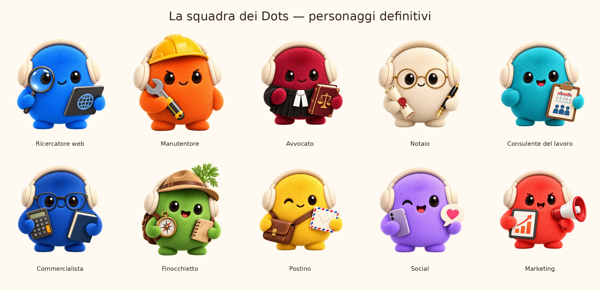

# Dots: agenti AI con la loro faccia

Dieci mascotte statiche con personalità e istruzioni pronte, più due personaggi per gli assistenti: **Jarvis** (il capo della squadra, per la webapp su PC e Mac) e **JBoss** (il rapper, per l'app Android). Sono pensate per Jarvis, ma si usano in qualunque sistema di agenti.

## Cosa c'è

| Cartella | Contenuto |
|---|---|
| `02_WEBP_HD` | i 10 agenti in WebP senza perdita, con trasparenza |
| `03_AVATAR` | ogni agente in PNG e WebP da 1024, 512, 256, 128 e 64 px |
| `04_SCHEDE_AGENTI` | missione, personalità e istruzioni copiabili (una scheda per agente) |
| `05_PROMPT_VISIVI` | i prompt usati per generare le immagini |
| `06_ANTEPRIMA` | tavola dei concept e tavola dei personaggi finali |
| `Jarvis/` | Jarvis, capo della squadra (webapp PC e Mac) |
| `JBoss/` | JBoss, il rapper (app Android) |
| `agenti.json` | ruoli, immagini e istruzioni in un unico file |

Gli agenti: Ricercatore web, Manutentore, Avvocato, Notaio, Consulente del lavoro, Commercialista, Finocchietto, Postino, Social, Marketing.

## Come si usano

- Schede grandi: PNG o WebP HD. Chat e liste: avatar da 128 o 256 px; 64 px solo in spazi molto piccoli.
- Mostra il personaggio intero: un ritaglio circolare nasconde gli accessori.
- Le immagini non hanno sfondo. Su fondo scuro la trasparenza può sembrare nera.
- Copia il `system_prompt` dalla scheda o da `agenti.json` nel tuo sistema di agenti. Il JSON è generico: per Jarvis o altri sistemi serve un piccolo adattamento.
- Strumenti, account e automazioni si collegano a parte. I ruoli professionali (avvocato, notaio, commercialista, consulente del lavoro) sono assistenti AI di supporto: le istruzioni non danno qualifiche né poteri professionali.

## Risoluzione

Gli originali sono 1254 × 1254 px, come li ha restituiti il generatore (era stata chiesta una generazione a 2048 × 2048). Non sono stati ingranditi: le versioni più piccole sono riduzioni.

## Origine e licenza

I personaggi derivano visivamente dai Dots di [OpenDots / CopilotKit](https://github.com/CopilotKit/OpenDots), Copyright (c) Atai Barkai, licenza MIT. Le varianti sono state generate con IA usando le immagini originali come riferimento.

Questo repository è sotto licenza **MIT** (file `LICENSE`, con il copyright originale e il testo in `LICENSE-OpenDots.txt`). Se riusi o ridistribuisci le immagini, tieni insieme l'avviso di copyright e la licenza. Le immagini sono file statici: nessun software eseguibile.
